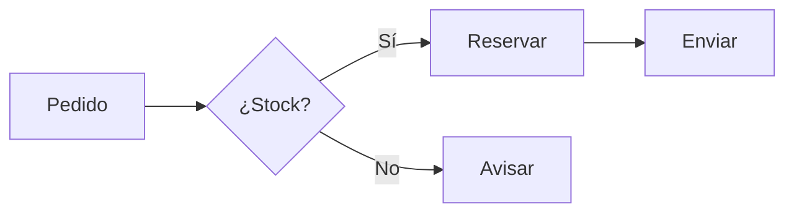

# Dibujo y visualización

Skill unificada de dibujo: absorbe a las antiguas `svg` (vectorial) y `canvas-design` (posters/arte) y añade diagramas, planos y edición de imágenes con Python. Todo el conocimiento está embebido aquí.

## Cómo usar esta skill (enrutador)

Toda tarea pasa por este circuito — no saltes pasos:

1. **Clasifica** la petición con el Árbol de decisión (una sola tecnología por tarea).
2. **Lee la referencia** indicada en la tabla de enrutaje (solo esa; nunca todas de golpe).
3. **Ejecuta el script** de `scripts/` (o el código embebido solo si no hay script que lo cubra).
4. **Verifica** el artefacto (§7) antes de entregar.

| Si te piden... | Ve a |
|---|---|
| Diagrama (flujo, secuencia, ER, clases, red, BPMN, organigrama, cuadrantes...) | `references/tipos-diagrama.md` → §1 y sus atajos |
| Diagrama como texto rico (UML, grafo grande, proceso formal) | `references/diagramas-texto.md` (PlantUML/Graphviz/BPMN) |
| Arquitectura de sistema o vista de red | `references/arquitectura-c4.md` + §1.3 |
| Diagrama a mano alzada / boceto | `references/hand-drawn.md` |
| Gráfico de datos o histograma animado | §1.2 → `scripts/grafico.py`, `scripts/histograma_animado.py` |
| Circuito eléctrico | §2 → `scripts/circuito.py` |
| Plano 2D/3D o plano de ingeniería con cotas/DXF | §3 + `references/ingenieria.md` → `scripts/plano_2d.py` |
| Figura 3D de datos (superficie, nube, barras, GIF rotatorio) | `references/planos-3d.md` → `scripts/plot3d.py` |
| Máquina isométrica interactiva | §3.4 → `references/maquinas-isometricas.md` |
| Logo, icono, SVG, infografía | §4 (SVG embebido) + `references/animation|filters|attributes` |
| Poster, cartel, arte digital | §5 |
| Arte algorítmico/generativo | `references/arte-algoritmico.md` |
| Editar o convertir IMAGEN (recorte, filtro, denoise, extensión) | §6 → `scripts/editar_imagen.py`, `scripts/convertir.py` |
| Editar/comprimir/denoise VÍDEO o GIF desde vídeo | `references/video-edicion.md` → `scripts/video.py` |
| AUDIO (convertir, normalizar LUFS, silencios, mezcla, waveform) | `references/audio-tools.md` → `scripts/audio.py` |
| Motion graphic / MP4 desde HTML | §8.2 → `references/video-html.md` |
| Animar un dibujo (animatic, clip) | §8 → `references/animacion-ia.md` |
| Dudas de flags/formatos de entrada | `references/scripts.md` |
| Falta una herramienta instalada | `references/instalacion.md` (instalación única por equipo) |

Primer encargo nuevo = leer `references/como-hacerlo.md` (secuencia completa spec → script → conversión → verificación). Encargos con datos/estilo multimedia = `references/multimedia-diseno.md`.

## Árbol de decisión — elige UNA tecnología

| El usuario pide... | Tecnología por defecto | Fallback |
|---|---|---|
| Diagrama de flujo/secuencia/ER/UML | Mermaid → SVG/PNG | draw.io XML |
| Arquitectura cloud/infraestructura | Python `diagrams` (Graphviz) | Mermaid |
| Gráfico de datos (barras, líneas, series, distribuciones) | `matplotlib` | SVG a mano |
| Diagrama editable / pizarra | draw.io XML o Excalidraw JSON | Mermaid |
| Circuito eléctrico | `schemdraw` | SVG con símbolos IEC |
| Plano 2D/3D, planta, isométrico, cotas | SVG a escala | `matplotlib` 3D / `ezdxf` |
| Superficie/nube/barras 3D o vista rotatoria | `scripts/plot3d.py` | SVG isométrico |
| Máquina/instrumento/mueble como objeto interactivo | SVG isométrico de código (HTML) | PNG estático |
| Logo, icono, ilustración, infografía, animación | SVG (a mano) | PNG con Pillow |
| Animación de un dibujo / animatic / clip corto | Flujo dibujo→video con referencia | `scripts/histograma_animado.py` |
| Motion graphic / video corto en MP4 desde HTML | Composición HTML seekable → motor de video | GIF (§1.2) |
| Infografía o panel de datos autocontenido | HTML + SVG inline | SVG suelto |
| Poster, cartel, afiche, arte digital | Flujo filosofía + lienzo PNG/PDF | SVG |
| Recortar, redimensionar, filtros, transparencia, GIF | `scripts/editar_imagen.py` | ImageMagick |
| Editar vídeo (recorte, filtro, denoise, comprimir, frames) | `scripts/video.py` (FFmpeg) | HandBrake |
| Audio (convertir, normalizar, silencios, mezcla, waveform) | `scripts/audio.py` (FFmpeg) | sox |
| Convertir extensión (imagen/vídeo/audio) | `scripts/convertir.py` | motor propio del tipo |
| Convertir SVG → PNG/PDF | `cairosvg` | `svglib`/`inkscape` |

Regla: una tarea = una tecnología. Si dudas entre dos, sigue la tabla; si el formato final importa más que el proceso, elige el de «por defecto».

## Flujo base: planifica → genera → renderiza → verifica

1. **Planifica**: tamaño/escala de salida, formato final (default: SVG vectorial, PNG raster), público y si necesita transparencia.
2. **Genera**: escribe el código o SVG en un fichero ejecutable; nada de snippets que no se ejecuten.
3. **Renderiza**: ejecuta y produce el artefacto real.
4. **Verifica**: fichero existe, no vacío, dimensiones esperadas (§7 `info`).

## 1. Diagramas

### 1.1 Mermaid (flujo, secuencia, ER, clases, estados, mindmap, Gantt)

````

````

Render a SVG/PNG con `@mermaid-js/mermaid-cli`:

```bash
mmdc -i d.mmd -o d.svg                 # vectorial
mmdc -i d.mmd -o d.png -w 1600         # raster
mmdc -i d.mmd -o d.svg -t dark          # default|dark|forest|neutral
```

Atajo: `python scripts/render_mermaid.py d.mmd -o d.svg` (o sobre un `.md`: extrae el primer bloque; `--ancho`, `--tema dark`).

Errores típicos: paréntesis en etiquetas sin comillas (`A[texto (x)]` → `A["texto (x)"]`), `--` usado como nodo en vez de arista, `end` ausente en subgrafos.

### 1.2 matplotlib (gráficos de datos)

Atajo: `python scripts/grafico.py datos.csv --tipo bar|line|area|scatter|hist|pie --x col --y col1,col2 -o g.png` (`--transparente`, `--svg`, `--dpi`; ver `references/scripts.md`). El código de abajo es para cuando necesites control total.

```python
import matplotlib
matplotlib.use("Agg")          # sin display, ANTES de importar pyplot
import matplotlib.pyplot as plt

fig, ax = plt.subplots(figsize=(8, 4.5))
ax.bar(categorias, valores, color="#4F46E5")
ax.set(xlabel="Mes", ylabel="Ventas (USD)", title="Ventas 2026")
ax.tick_params(axis="x", rotation=45)
ax.grid(True, alpha=0.3)
fig.tight_layout()
fig.savefig("ventas.png", dpi=300, transparent=True, bbox_inches="tight")
plt.close(fig)                # siempre cerrar en lotes
```

| Tipo | Llamada |
|---|---|
| Línea / serie temporal | `ax.plot(x, y)` / `ax.plot_date(fechas, y)` |
| Barras / horizontales | `ax.bar` / `ax.barh` |
| Dispersión | `ax.scatter(x, y, s=tam, c=valor, cmap="viridis")` |
| Histograma | `ax.hist(datos, bins=30)` |
| Pastel | `ax.pie(valores, labels=..., autopct="%1.1f%%")` |
| Paneles múltiples | `fig, axes = plt.subplots(2, 2, figsize=(10, 8))` |
| Doble eje | `ax2 = ax.twinx()` |
| 3D | `fig = plt.figure(); ax = fig.add_subplot(projection="3d")` |
| Anotación | `ax.annotate("pico", xy=(x, y), arrowprops=dict(arrowstyle="->"))` |

Reglas: unidades en el label; leyenda solo con >1 serie (`ax.legend()`); un color fijo por serie; API OO (`fig, ax`) — `pyplot` solo para crear figura y guardar.

#### Histogramas animados

Atajo: `python scripts/histograma_animado.py --simular 500 -o hist.gif` (o `datos.csv --columna valor --frames 40`; `--evolutivo`, `--mp4`). El código de abajo explica el mecanismo por si hay que variarlo:

```python
import matplotlib
matplotlib.use("Agg")
import matplotlib.pyplot as plt
from matplotlib.animation import FuncAnimation, PillowWriter
import numpy as np

rng = np.random.default_rng(42)
datos = rng.normal(loc=0, scale=1, size=(60, 500))   # 60 frames, 500 valores c/u

fig, ax = plt.subplots(figsize=(8, 4.5))
bins = np.linspace(-4, 4, 40)                        # bins FIJOS en todos los frames

def actualizar(i):
    ax.cla()
    ax.hist(datos[:i + 1].ravel(), bins=bins, color="#4F46E5",
            edgecolor="white")
    ax.set(xlim=(-4, 4), xlabel="Valor", ylabel="Frecuencia",
           title=f"Histograma acumulado — frame {i + 1}/{len(datos)}")
    ax.grid(True, alpha=0.3)

anim = FuncAnimation(fig, actualizar, frames=len(datos), interval=120)
anim.save("histograma.gif", writer=PillowWriter(fps=8))   # GIF sin ffmpeg
plt.close(fig)
# MP4 (requiere ffmpeg en el PATH):
# anim.save("histograma.mp4", writer="ffmpeg", fps=24, dpi=150)
```

Variantes: distribución **que evoluciona** (histograma por frame de datos independientes en vez de acumulado), **comparación lado a lado** (dos series con `ax.hist(..., alpha=0.5)` actualizadas por frame), o **3D temporal** (`ax.bar3d` por capa de tiempo).

Reglas del gif de histograma:

- `bins` y `xlim` **constantestodos los frames**: si los ejes cambian, el gif "baila" y no se compara nada.
- `PillowWriter` para GIF (sin dependencias externas); `ffmpeg` solo para MP4.
- Frames largos (>100): evita `ax.cla()` en cada frame (redibuja todo); en su lugar quita solo las barras (`for p in ax.patches: p.remove()`) y actualiza alturas sobre `ax.bar` precreado.
- `interval=120` ms para datos que se leen; 40–80 ms para transiciones suaves. Siempre `plt.close(fig)` al final.

### 1.3 Arquitectura cloud con `diagrams` (Diagram as Code)

```python
from diagrams import Diagram
from diagrams.aws.compute import EC2
from diagrams.aws.database import RDS
from diagrams.aws.network import ELB

with Diagram("Web service", show=False, outformat="png", filename="web"):
    ELB("lb") >> EC2("web") >> RDS("db")
```

- Requiere **Graphviz del sistema** además de `pip install diagrams` (verificar: `dot -V`; Windows: `winget install Graphviz.Graphviz`).
- Proveedores: `diagrams.aws.*`, `azure.*`, `gcp.*`, `k8s.*`, `onprem.*`, `generic.*`, `saas.*`, `programming.*`.
- Versionado de nodo: `EC2("web", "t2.micro", version="2016.11.5")`.
- Sin Graphviz: generar DOT y renderizar `dot -Tsvg g.dot -o g.svg`.
- Exporta PNG por defecto; para vectorial exporta DOT → `dot -Tsvg`.

### 1.4 draw.io / Excalidraw (editables)

Elegir cuando el usuario quiera **reabrir y editar** (pizarra, revisión de equipo):

- **draw.io**: entregable `.drawio` (XML `mxGraphModel` con `mxCell` por nodo/arista); app.diagrams.net. Ideal para flujos grandes y redes.
- **Excalidraw**: `.excalidraw` (JSON); excalidraw.com. Estilo a mano alzada, bocetos rápidos.
- Mermaid en su lugar cuando el diagrama viva dentro de Markdown (versionable como texto, render nativo en GitHub/Obsidian).

### 1.5 Estilo editorial (documentos y presentaciones)

- Un único HTML autocontenido con SVG inline: se abre en navegador y se captura a PNG.
- Paleta limitada: 2 acentos + 2 neutros; una sola tipografía; flechas con `stroke-linecap="round"`; etiquetas 12–14px.
- Gramática única: nodo = caja redondeada; relación = flecha etiquetada; agrupación = contorno punteado.
- Tipos cubiertos por esta gramática: arquitectura, cuadrantes (impacto/esfuerzo), secuencia, jerárquicos, timeline, mindmap, matriz, embudo.

## 2. Circuitos eléctricos

### 2.1 `schemdraw` (recomendada — código Python)

Atajo: `python scripts/circuito.py --tipo rc|rlc|led|divisor|puente -o c.svg --etiquetas "R=10kΩ,C=100nF"` — 5 circuitos IEC listos; si el tuyo no está, copia y adapta su bloque. El código de ejemplo es para circuitos nuevos:

```python
import schemdraw
import schemdraw.elements as elm

with schemdraw.Drawing() as d:
    d += elm.Dot(open=True).label("V+", loc="bot")
    d += elm.Resistor().down().label("10kΩ")
    d += elm.LED().down().label("D1")
    d += elm.Ground()
    d.save("circuito.svg")   # convertir a PNG con §7
```

Símbolos: `Resistor`, `Capacitor`, `Inductor`, `Diode`, `LED`, `Battery`, `Switch`, `Ground`, `Lamp`, `Relay`, `Motor`. Valores con `.label("10kΩ", loc="right")`.

### 2.2 SVG a mano (control total de página e impresión)

- **Símbolos IEC 60617**: resistencia = rectángulo (no zigzag NEMA); fusible = rectángulo con línea; interruptor = línea con segmento en ángulo.
- Rejilla de 10u; cables solo horizontales/verticales, esquinas a 90°; nodo = círculo relleno `r="3"`.
- Nomenclatura: `L`, `N`, `PE` (instalación); `R1`, `C1`, `Q1`, `F1` (electrónica).

## 3. Planos 2D/3D

### 3.1 Plano 2D a escala

Atajo: `python scripts/plano_2d.py plano.json -o plano.svg --abrir` — genera rejilla de 50cm, muros, rótulos con dimensiones, cotas y cajetín desde un spec JSON (formato en `references/scripts.md`). Lo de abajo es para refinar a mano el SVG resultante:

1. Dibujar en unidades reales (cm) en el viewBox y anotar escala (`E: 1/50`) en el cajetín.
2. Capas por orden: rejilla → muros (trazo grueso) → cotas → mobiliario (trazo fino) → textos → cajetín.
3. Cotas: línea fina con flechas y número, separada 8u del muro; muro exterior 3× de espesor que interior.

Esqueleto SVG:

```xml
<svg xmlns="http://www.w3.org/2000/svg" viewBox="0 0 1189 841" role="img">
  <title>Planta — escala 1:50</title>
  <g stroke="#111" fill="none" stroke-width="6">            <!-- muros -->
    <rect x="40" y="40" width="1109" height="761"/>
  </g>
  <g stroke="#666" stroke-width="1">                        <!-- cotas -->
    <line x1="40" y1="820" x2="1149" y2="820"/>
  </g>
  <g font-family="sans-serif" font-size="16" fill="#111">   <!-- textos --></g>
</svg>
```

### 3.2 Isométrico / 3D

Atajo: `python scripts/plot3d.py superficie|nube|barras|malla ... -o f.png [--gif f.gif]` (proyecciones y calidad: `references/planos-3d.md`). El código de abajo es la receta base:

- Isométrico en SVG: proyectar a mano con `x' = (x-y)·cos30°`, `y' = (x+y)·sin30° - z`.
- Volumen real:

```python
import matplotlib; matplotlib.use("Agg")
import matplotlib.pyplot as plt, numpy as np
fig = plt.figure(figsize=(7, 6))
ax = fig.add_subplot(projection="3d")
X, Y = np.meshgrid(np.linspace(-2, 2, 60), np.linspace(-2, 2, 60))
ax.plot_surface(X, Y, np.sin(X**2 + Y**2), cmap="viridis", alpha=0.9)
fig.savefig("superficie.png", dpi=200, transparent=True)
plt.close(fig)
```

### 3.3 DXF/CAD

- `pip install ezdxf` cuando pidan «archivo para AutoCAD» o capas CAD editables.
- Convención: capas `MUROS`, `COTAS`, `TEXTO`, `MOBILIARIO`; unidades milímetros; `INSUNITS = 4`.
- DXF → PNG con Inkscape (`inkscape a.dxf -o a.png`). SVG → DXF no es fiable con curvas: regenerar desde el modelo.

### 3.4 Máquinas isométricas (objeto dibujado como código)

Para «explica/dibuja esta máquina como objeto real e interactivo» (motor, instrumento, mueble): cifras verdaderas → lista de partes → kit isométrico (§3.2 fórmulas + primitivas) → pintar de atrás hacia delante → auditar intersecciones y apoyos. Sombreado de 4 tonos por orientación de cara; capa opcional de efectos (fuego/agua/luz) sin romper el SVG. Metodología completa, primitivas y checklist en `references/maquinas-isometricas.md`. No usar para datos ni personas/mapas (son otros encargos).

## 4. Arte vectorial SVG

### Reglas duras

1. `viewBox` siempre para escalado correcto; `xmlns="http://www.w3.org/2000/svg"` obligatorio.
2. Accesibilidad: `role="img"`, `<title>`, `<desc>`.
3. Gradientes, filtros e iconos reutilizables en `<defs>`; repetidos con `<use href="#id">`.
4. Stroke dentro del viewBox (un stroke de 4px centrado en el borde pierde 2px); filtros con margen (`x="-20%" y="-20%" width="140%" height="140%"`).
5. Paths legibles con saltos de línea; coordenadas a 2–3 decimales.

### Comandos de path

| Comando | Acción |
|---|---|
| `M x,y` | Mover (absoluto) |
| `L x,y` | Línea |
| `H x` / `V y` | Horizontal / vertical |
| `Q cx,cy x,y` | Bézier cuadrática |
| `C c1x,c1y c2x,c2y x,y` | Bézier cúbica |
| `Z` | Cerrar path |

Mayúscula = absoluto; minúscula = relativo.

### Elementos básicos

| Elemento | Uso |
|---|---|
| `<rect>` / `<circle>` / `<ellipse>` | Rectángulo / círculo / elipse |
| `<line>` / `<polygon>` | Línea / polígono |
| `<path>` | Trazado genérico |
| `<text>` / `<textPath>` | Texto y texto curvo |
| `<g>` | Grupo |
| `<use>` | Reutilizar con `href="#id"` |

### Relleno, degradados y filtros

```xml
<circle fill="#4F46E5" fill-opacity="0.5"/>
<path stroke="#FF6B6B" stroke-width="4" stroke-linecap="round"/>

<defs>
  <linearGradient id="grad" x1="0%" y1="0%" x2="100%" y2="100%">
    <stop offset="0%" stop-color="#667eea"/>
    <stop offset="100%" stop-color="#764ba2"/>
  </linearGradient>
  <filter id="sombra" x="-20%" y="-20%" width="140%" height="140%">
    <feDropShadow dx="2" dy="2" stdDeviation="3" flood-opacity="0.3"/>
  </filter>
</defs>
<g transform="translate(50,30) rotate(45) scale(1.5)">...</g>
```

### Animación

Prefiere CSS; SMIL solo si el soporte lo requiere:

```css
circle { transition: r 400ms, fill 600ms; }
button:hover circle { r: 50; fill: #7C3AED; }
```

### Exportación y optimización

Atajo: `python scripts/svg_a_raster.py in.svg -o out.png --escala 2` (cadena cairosvg → svglib → inkscape; PDF con `-o out.pdf`, ancho con `--ancho-px`). Útiles directos:

```bash
inkscape input.svg --export-type=png --export-filename=output.png
python -c "import cairosvg; cairosvg.svg2png(url='in.svg', write_to='out.png', scale=2)"
rsvg-convert -w 800 input.svg -o output.png
npx svgo file.svg                                  # optimizar
```

- Eliminar metadata de editores; redondear coordenadas; combinar paths similares; `<use>` para repetidos.

## 5. Posters y arte (heredado de `canvas-design`)

Flujo en dos pasos, siempre en este orden:

1. **Filosofía de diseño (.md)**: nombra el movimiento (1-2 palabras), escribe 4-6 párrafos articulando espacio/forma, color/material, escala/ritmo, composición/equilibrio, jerarquía visual. Sin redundancias; enfatiza artesanía («meticulosamente elaborado», «ejecución de nivel maestro»); deja margen interpretativo.
2. **Expresión visual (PNG o PDF)**: una única página altamente visual; 90% diseño, 10% texto esencial. Deducir la referencia conceptual sutil del tema e incrustarla de forma invisible (como una cita de jazz: solo quien la conoce la nota).

Reglas del lienzo:

- **Texto mínimo**: palabras esenciales integradas como elemento visual, nunca párrafos; nada se sale ni se superpone; márgenes con respiración.
- **Fuentes**: usar las de `canvas-fonts/` (46 fuentes OFL dentro de esta skill, no del cwd); alternar familias; por defecto peso fino.
- **Refinamiento**: si «no es perfecto», NO añadir elementos: pulir composición, espaciado, color y tipografía; segunda pasada sobre el mismo código.
- **Originalidad**: diseños propios; jamás copiar obra de otros artistas (copyright).
- **Multipágina** solo si se pide: primera página = original; siguientes = giros coherentes, como un libro de mesa de café.

Salida: un `.png`/`.pdf` + la filosofía `.md`.

## 6. Scripts preestablecidos (usa estos; no reescribas código)

Todos en `scripts/`, probados, con mensajes de error que indican el `pip install` exacto. Uso completo de cada uno (todos los argumentos y ejemplos): `references/scripts.md`.

| Script | Hace | Ejemplo mínimo |
|---|---|---|
| `editar_imagen.py` | Pillow: info, recortar, redimensionar, filtro, transparencia, GIF, contacto, superponer | `python scripts/editar_imagen.py info foto.jpg` |
| `grafico.py` | CSV → gráfico PNG/SVG (`bar/line/area/scatter/hist/pie`) | `python scripts/grafico.py d.csv --tipo bar --x mes --y ventas -o g.png` |
| `histograma_animado.py` | GIF/MP4 de histograma animado (acumulado o evolutivo) | `python scripts/histograma_animado.py --simular 500 -o h.gif` |
| `svg_a_raster.py` | SVG → PNG/PDF (cadena cairosvg → svglib → inkscape) | `python scripts/svg_a_raster.py in.svg -o out.png --escala 2` |
| `render_mermaid.py` | `.mmd` o bloque `mermaid` de Markdown → SVG/PNG | `python scripts/render_mermaid.py d.mmd -o d.svg` |
| `circuito.py` | Circuitos IEC: `rc`, `rlc`, `led`, `divisor`, `puente` | `python scripts/circuito.py --tipo rc -o rc.svg` |
| `plano_2d.py` | Plano a escala desde spec JSON (sin dependencias) | `python scripts/plano_2d.py plano.json -o plano.svg` |
| `video.py` | FFmpeg: info, convertir, recortar, filtro/denoise, comprimir, frames, gif, ensamblar | `python scripts/video.py convertir a.mov -o a.mp4` |
| `audio.py` | FFmpeg: convertir, normalizar LUFS (2 pasadas), silencios, mezcla/ducking, waveform | `python scripts/audio.py normalizar voz.mp3 -o voz.wav` |
| `convertir.py` | Punto único de cambio de extensión imagen/vídeo/audio (enruta a los anteriores) | `python scripts/convertir.py a.png -o a.webp` |
| `plot3d.py` | Figuras 3D: superficie, malla, nube, barras + GIF rotatorio | `python scripts/plot3d.py superficie -o s.png --gif s.gif` |

- La secuencia de trabajo de cada tipo de encargo (spec → script → conversión → verificación) está en `references/como-hacerlo.md` — léelo ANTES de empezar un encargo que no hayas hecho antes.
- Código Pillow/Matplotlib ad-hoc solo cuando el script no cubra el caso (p. ej. umbral por canal para fondos con degradado).
- Si un circuito o plano no encaja en el spec, copia el script más cercano y modifícalo; no empieces en blanco.

## 7. Verificación de resultados

```bash
python scripts/editar_imagen.py info salida.png     # esperado: anchoxalto RGBA/RGB PNG
```

Checklist antes de entregar: existe el fichero · no está vacío · dimensiones correctas · texto legible y sin solapes · fondo correcto (transparente si se pidió) · colores sin bandas (GIF: paleta única, `disposal=2`).

## 8. Animación de dibujos con IA

Cuando pidan animar un dibujo propio (boceto, ilustración, personaje): preparar el dibujo (pose legible, fondo simple, recorte limpio), dirigir la acción en orden de acontecimientos («mira, hace pausa, sonríe») con cámara y estilo explícitos, y mantener coherencia de personaje con vistas de referencia entre tomas. Storyboard de 2-3 bocetos antes de generar. Detalle completo en `references/animacion-ia.md`. Para animación sin herramienta de video, el camino propio es GIF/MP4 con matplotlib (§1.2, histogramas animados).

### Video desde HTML (motion graphics → MP4)

Para «hazme un vídeo corto / motion graphic / titular animado»: composición HTML con atributos de tiempo (`class="clip"`, `data-start`, `data-duration`, `data-track-index`), animaciones **seekable** (timeline GSAP `paused:true` en `window.__timelines`; prohibido `setTimeout`/reloj propio) y render determinista (motor `hyperframes`: `npx hyperframes init|preview|render`, requiere Node 22+ y FFmpeg). Plan de escenas con tiempos ANTES de escribir HTML. Contrato completo, tipología de motion y fallbacks en `references/video-html.md`.

## Índice de referencias (contenido propio, sin delegar)

Esta skill es **autocontenida**: se resuelve con este fichero + sus `references/`; **nunca carga ni invoca otras skills**. Lee SOLO la referencia que toque el enrutador, nunca el índice entero:

**Diagramas y arquitectura**

| Referencia | Cuándo leerla |
|---|---|
| `references/tipos-diagrama.md` | PRIMERO para cualquier diagrama: mapa de ~24 tipos → herramienta + fórmulas visuales |
| `references/diagramas-texto.md` | UML rico, grafos grandes o procesos formales (PlantUML / Graphviz DOT / BPMN) |
| `references/arquitectura-c4.md` | Arquitectura de sistema o vista de red (niveles C4, zonas, puertos) |
| `references/hand-drawn.md` | Si piden estilo boceto/pizarra (Excalidraw JSON, filtro de temblor) |

**Planos, ingeniería y 3D**

| Referencia | Cuándo leerla |
|---|---|
| `references/ingenieria.md` | Planos técnicos: vistas ortogonales, cotado ISO, tolerancias, DXF con `ezdxf` |
| `references/planos-3d.md` | Figuras 3D: proyecciones, `plot3d.py`, calidad de render, límites CAD |
| `references/maquinas-isometricas.md` | Objeto/máquina como figura isométrica interactiva (kit, sombreado, auditoría) |

**Imagen, vídeo, audio y multimedia**

| Referencia | Cuándo leerla |
|---|---|
| `references/video-edicion.md` | Editar/converter vídeo: formatos, CRF, denoise, GIF de calidad, frames↔ondas |
| `references/audio-tools.md` | Audio: formatos, normalización LUFS 2 pasadas, silencios, ducking, waveform |
| `references/video-html.md` | Motion graphic/MP4 desde HTML seekable (contrato `data-*`, bucle de render) |
| `references/animacion-ia.md` | Animar un dibujo propio (animatic): dirección de acción, coherencia |
| `references/multimedia-diseno.md` | Prompts creativos, estilos editoriales/retro-tech, lotes y QA de entrega |
| `references/arte-algoritmico.md` | Arte generativo/abstracto con código (Lissajous, espirales, estilos) |

**SVG (heredado de la skill `svg`)**

| Referencia | Cuándo leerla |
|---|---|
| `references/paths.md` | Comandos de path con ejemplos y arcos (al escribir paths) |
| `references/attributes.md` | Atributo/estilo SVG concreto (duda de referencia) |
| `references/animation.md` | Animación CSS/SMIL/JS (solo si piden animar el SVG) |
| `references/filters.md` | Sombras, blur, texturas (solo si piden efectos) |
| `references/best-practices.md` | Antes de ENTREGAR cualquier SVG (optimización, a11y, export) |

**Operación**

| Referencia | Cuándo leerla |
|---|---|
| `references/como-hacerlo.md` | PRIMERO en un encargo nuevo: secuencia spec → script → conversión → verificación |
| `references/scripts.md` | Flags, formatos de entrada y errores de los 11 scripts |
| `references/instalacion.md` | Si falta una herramienta: instalación única por equipo (winget/apt/npm/carpeta portable) |

## Dependencias

```bash
# Núcleo (imagen + gráficos)
pip install pillow matplotlib
# Video y audio — FFmpeg UNA vez en el equipo (ver references/instalacion.md)
#   Windows: winget install Gyan.FFmpeg   |   Linux: apt install ffmpeg   |   macOS: brew install ffmpeg
# Por tarea, solo lo que haga falta:
pip install diagrams                     # arquitectura cloud (requiere Graphviz del SO)
pip install schemdraw                    # circuitos
pip install ezdxf                        # DXF/CAD
pip install cairosvg                     # SVG -> PNG (si falta la DLL de Cairo: svglib, ver instalacion.md)
pip install svglib reportlab             # SVG -> PDF puro Python
npm install -g @mermaid-js/mermaid-cli   # render Mermaid (mmdc)
# Motion MP4 desde HTML: Node.js 22+ y FFmpeg -> npx hyperframes init mi-video
```

Instala solo lo que la tarea pida (una vez por equipo); **si algo falta o no se ve, sigue `references/instalacion.md`** — los scripts ya avisan con el comando exacto.

## Anti-patrones

- Entregar sin renderizar y verificar: el PNG sale en blanco o a 72dpi. *Razón*: hay que ejecutar y comprobar dimensiones.
- Mezclar tecnologías en un mismo diagrama (mitad Mermaid, mitad SVG a mano): estilos incoherentes e irresolubles; elige una y haz fallback completo.
- SVG sin `viewBox` ni `xmlns`: se rompe al escalar o incrustar.
- GIF con paleta recalculada por frame: parpadeo de fondo; usar paleta única y `disposal=2`.
- Editar originales en lote sin copia de salida: pérdida irreversible.
- Símbolos eléctricos inventados o mezcla IEC+NEMA en un mismo esquema: ilegible para quien lo lee.
- Escala cambiada entre vistas de un mismo plano: rompe la coherencia del plano.
- Copiar arte o posters existentes: riesgo de copyright; crear diseños originales.
- Añadir elementos cuando «no es perfecto»: pulir composición, espaciado, color y tipografía antes de añadir ruido.
