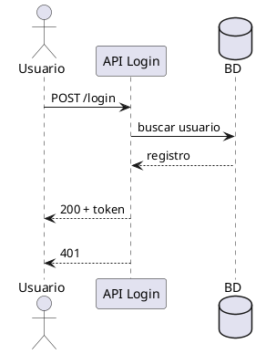
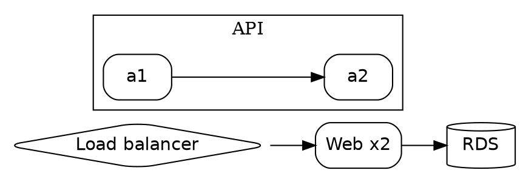

# Diagramas como texto — PlantUML, Graphviz DOT, BPMN

Familia de diagramas escritos como texto y compilados a imagen. Elegir según dónde viva el diagrama y quién lo reabra.

Índice: [1 Cuándo](#1-cuándo-cada-uno) · [2 PlantUML](#2-plantuml) · [3 Graphviz DOT](#3-graphviz-dot) · [4 BPMN](#4-bpmn)

## 1 Cuándo cada uno

| Necesidad | Elección | Por qué |
|---|---|---|
| Diagrama dentro de Markdown (GitHub/Obsidian) | Mermaid (§1.1) | render nativo, sin tooling |
| UML clásico rico (secuencia con actores, casos de uso, clases con miembros) | PlantUML | sintaxis UML completa y probada |
| Grafo con layout automático complejo (cientos de nodos, clustering) | Graphviz DOT | el motor de layouts es superior |
| Proceso de negocio con semántica formal (eventos, gateway, BPMN 2.0) | BPMN | notación estándar, intercambiable |
| Diagrama editable a mano | draw.io / Excalidraw (`references/como-hacerlo.md` §4) | lo reabren personas |

Regla: NO mezclar notaciones en un mismo entregable; si el destino es Excel/PowerPoint de negocio, BPMN o Mermaid; si es docs de ingeniería, PlantUML/DOT.

## 2 PlantUML

Requiere el binario `plantuml` (o Graphviz para su layout). Archivo `.puml`:



```bash
plantuml -tpng login.puml        # PNG junto al fichero
plantuml -tsvg login.puml        # vectorial (preferir)
plantuml -charset UTF-8 a.puml   # acentos correctos
```

Constructores clave: `participant/actor/database`, `->:` mensaje, `alt/else/end`, `note over`, `package`, `class A { +metodo() }`, `A --> B : usa`. Errores típicos: `@enduml` mal escrito (cierra `@enduml`, no `@end`), diagramas sin `@startuml`.

## 3 Graphviz DOT

Requiere Graphviz (`dot -V`). Archivo `.dot`:



```bash
dot -Tsvg g.dot -o g.svg     # vectorial (preferir)
dot -Tpng g.dot -o g.png -Gdpi=200
dot -Tsvg g.dot               # validación rápida
```

Claves: `rankdir` controla dirección; `cluster_*` crea agrupaciones con borde; `shape=box|diamond|cylinder|ellipse`; `style=rounded,filled` + `fillcolor`; pesos con `weight` para insistir en aristas. Para decenas de nodos el layout automático gana a cualquier posición manual.

## 4 BPMN

Notación de procesos de negocio (eventos = círculos, actividades = rectángulos redondeados, gateways = rombos, flujos con flechas). Flujo de trabajo:

1. Mapear el proceso en papel: eventos de inicio/fin (círculo doble/final), tareas, decisiones (gateway exclusivo/paralelo).
2. Representar en draw.io (plantillas BPMN nativas) o como XML BPMN 2.0 si el destino es un motor de procesos.
3. Alternativa textual rápida: Mermaid `flowchart` con la misma geometría (inicio círculo, tarea rectángulo, decisión rombo) cuando no se exija validación BPMN formal.

Anti-patrones: tareas que no son verbos («Facturación» → «Generar factura»); gateway sin todas las ramas etiquetadas; eventos de fin ausentes; colgar flojos sin ruta de excepción.
